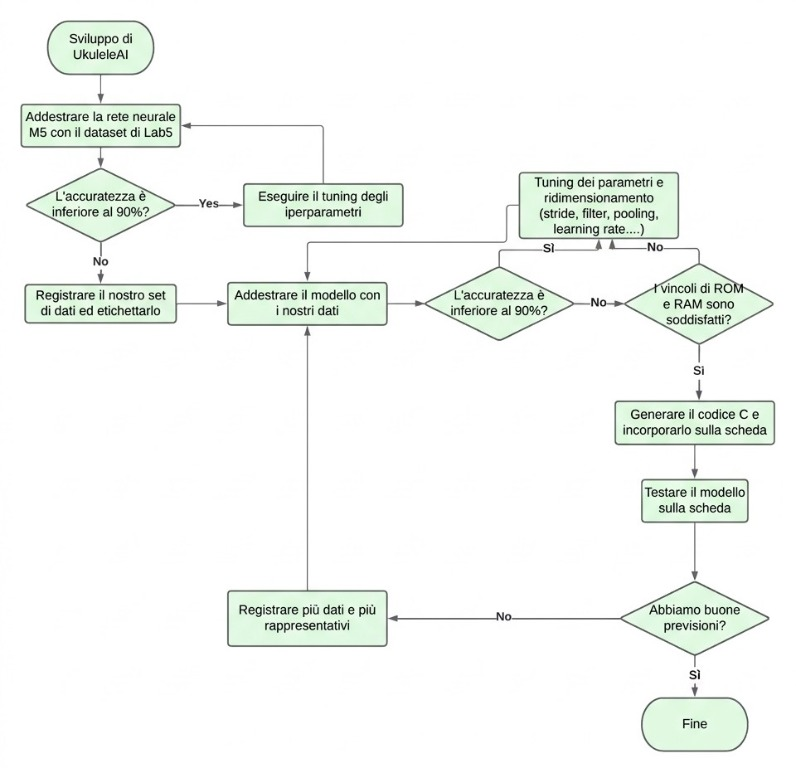

# UkuleleAI

- La cartella `Ukulele_recording` contiene il codice che invia i buffer della registrazione, separati da un delimitatore di caratteri.
- La cartella `Ukulele_inference` contiene il codice e il modello per effettuare previsioni in tempo reale.
- Il notebook contiene la migliore versione ottenuta durante i test per la CNN, che ha raggiunto il 90%.
- Il file Python `Receiving_splitting_wav.py` riceve i dati e crea il dataset in formato WAV (attualmente utilizzato).

Nota: nella confusion matrix, gli accordi più simili vengono confusi più facilmente.

# UkuleleAI - Progetto Audio

Questo progetto prevede il deployment di una rete neurale sulla scheda Nucleo-L476RG, dotata di un microcontrollore STM32L476RGT6 e di uno shield personalizzato per la cattura audio. Lo shield è composto da un TLV320ADC3101ADC e da un microfono AOM-5024L-HD-R, oltre a un jack stereo da 3.5”. Le architetture Embedded-AI stanno diventando sempre più importanti: consentono di implementare algoritmi di intelligenza artificiale su dispositivi a basso consumo, come i microcontrollori, per task quali il riconoscimento di immagini e della voce, migliorando la privacy, riducendo la latenza e aumentando l’efficienza.

## Obiettivo

L’obiettivo è sviluppare una rete neurale altamente accurata, in grado di classificare gli accordi di Ukulele, e integrarla sulla scheda Nucleo-L476RG. La rete viene addestrata per classificare sette accordi: A, B, C, D, E, F e G.

## Workflow

- Acquisizione di familiarità con l’addestramento di una rete neurale attraverso le attività di laboratorio.
- Creazione di un dataset registrando campioni di accordi di Ukulele tramite il microfono dello shield.
- Addestramento di un modello Convolutional Neural Network (CNN) utilizzando il dataset.
- Configurazione dell’architettura di processing sulla scheda tramite i protocolli ADC, DMA e I2S.
- Test live e valutazione delle prestazioni del modello.

## Modello CNN

L’architettura del modello si ispira a una pubblicazione sulle Neural Networks for Raw Waveforms. Include:
- un numero crescente di filtri per acquisire pattern complessi;
- MaxPooling iniziale per ridurre l’utilizzo della memoria;
- Average Pooling per estrarre le feature;
- modifiche al learning rate per l’ottimizzazione.

## Architettura di processing

Lo shield acquisisce i dati audio e li invia al microcontrollore per l’elaborazione tramite ADC e DMA. Il protocollo di comunicazione I2S viene utilizzato per trasmettere e ricevere dati audio digitali. L’inference della rete neurale viene eseguita sui dati audio e viene restituito l’accordo previsto.

## Risultati e analisi delle prestazioni

- Accuracy di training: 93%
- Accuracy di testing: 95%
- Occupazione RAM: 36.552 byte
- Latenza di inference: 295 millisecondi
- Accuracy stimata delle prediction live: 85%

L’analisi del consumo energetico del modello mostra una media di 62 mW in modalità active e un consumo trascurabile in modalità low-power, con un conseguente consumo medio complessivo.

